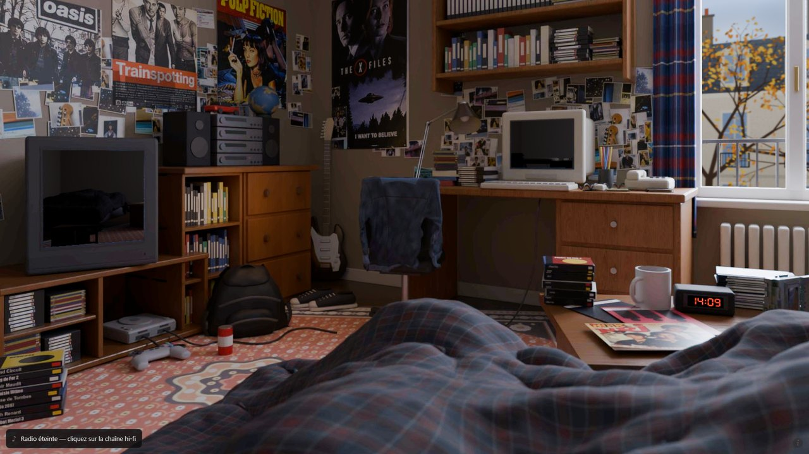

# TravelMachine

Une chambre d'adolescent de 1997, vivante, à l'heure qu'il est.

**Ouvrir la page : https://thibautgras.github.io/TravelMachine/**

## Ce qu'on y voit

- L'heure du réveil est l'heure réelle, et la lumière suit le soleil du jour, calculé pour l'endroit où vous êtes.
- Dehors, le ciel, la pluie, la neige, le brouillard, le vent ou l'orage suivent la météo réelle du lieu ; les arbres suivent la saison.
- Le regard suit la souris.
- On peut cliquer sur la chaîne hi-fi ou le radio-réveil (radio des années 90), la lampe, le téléviseur, l'écran de l'ordinateur et la tasse.

Il faut un navigateur récent sur ordinateur (WebGL 2). La page pèse environ 18 Mo : le premier chargement prend quelques secondes.

## Localisation et données

La page demande votre position pour régler le soleil et la météo. Si vous refusez, elle prend Paris. La position est arrondie à une dizaine de kilomètres et n'est envoyée qu'au service météo ; rien n'est enregistré.

## Crédits

- Données météo : [Open-Meteo.com](https://open-meteo.com/) (CC BY 4.0).
- Radio : flux en direct de webradios tierces (181.FM, 1.FM), lus depuis leurs serveurs.
- Pluie et tonnerre : enregistrement fourni par l'auteur.
- Ambiance de ville, interrupteurs et boutons : [BigSoundBank](https://bigsoundbank.com/) (Joseph Sardin), CC0.
- Scène modélisée et rendue dans Blender, puis assemblée en une page unique.

Ce dépôt ne contient que la page publiée. Les modèles et les scripts de fabrication n'en font pas partie.
